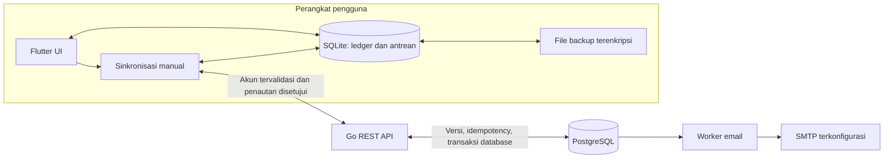

# Catat Uang

**Aplikasi keuangan pribadi dengan Flutter, SQLite, Go, dan PostgreSQL.**

Catat pemasukan, pengeluaran, dan tagihan tanpa koneksi atau akun. Saat membutuhkan salinan data akun, pengguna dapat menautkan ledger perangkat secara eksplisit dan menjalankan sinkronisasi manual. Login saja tidak mengunggah catatan lokal.

[](https://github.com/a1fariz/CatatUang/actions/workflows/backend.yml)
[](https://github.com/a1fariz/CatatUang/actions/workflows/mobile.yml)
[](https://github.com/a1fariz/CatatUang/actions/workflows/credentials.yml)

[Studi kasus](https://alfarizi.my.id/work/catat-uang) · [Jalankan lokal](#jalankan-lokal) · [Bukti pengujian](#bukti-pengujian) · [Skenario demo](docs/demo.md) · [Keamanan](SECURITY.md)

## Yang dibangun

| Bagian | Implementasi |
| --- | --- |
| Aplikasi mobile | Flutter/Dart, ledger SQLite, ringkasan periode, transaksi, tagihan berulang, pengingat lokal, serta pengaturan tampilan dan mata uang |
| Backend | REST API Go dengan `net/http`, `pgx`, PostgreSQL, dan migrasi skema eksplisit |
| Akun | Registrasi/login, hashing Argon2id, sesi yang dapat dicabut, ganti kata sandi, serta verifikasi email dan pemulihan akun melalui worker SMTP |
| Sinkronisasi | Penautan transaksi dan tagihan terpisah, antrean SQLite persisten, retry idempotent, pemeriksaan versi, serta peninjauan konflik dan perubahan dataset |
| Backup | File terenkripsi untuk data lokal tanpa token akun; pemulihan ke database kosong dalam satu transaksi SQLite |
| Operasional | Health/readiness, role database terpisah, backup server dan verifikasi restore pada salinan, pemeriksaan antrean email, serta pratinjau cleanup |

Project ini mencakup antarmuka Flutter, penyimpanan perangkat, protokol sinkronisasi, API, database, pengujian, dan konfigurasi operasional. Source tersedia untuk peninjauan; deployment publik dan distribusi production belum dilakukan.

## Arsitektur dan keputusan



- **Ledger lokal terlebih dahulu.** Transaksi dan tagihan tetap dapat dipakai offline. Pengguna memilih kapan data dihubungkan dan disinkronkan ke akun.
- **Retry mempertahankan identitas operasi.** Outbox persisten dan idempotency key membantu menangani respons hilang tanpa mengirim pembayaran sebagai operasi baru.
- **Konflik ditinjau.** Perubahan versi atau dataset menghentikan alur yang memerlukan keputusan pengguna; login/logout tidak memindahkan atau menghapus ledger.
- **Pembayaran memakai batas database.** Transaksi PostgreSQL, row lock, dan unique constraint menjaga konsistensi operasi pembayaran yang diuji terhadap request bersamaan dan retry.

Lihat [arsitektur backend](backend/docs/architecture.md), [protokol transaksi](backend/docs/transaction-sync.md), dan [protokol tagihan/pembayaran](backend/docs/bill-sync.md) untuk detail kontrak dan batasnya.

## Jalankan lokal

### 1. Flutter tanpa akun

Prasyarat: Flutter **3.38+** dengan Dart yang sesuai `mobile/pubspec.yaml`, Android SDK, dan target Android khusus pengembangan. CI yang tercatat memakai Flutter 3.47.6. Build iOS memerlukan macOS dan Xcode.

```sh
git clone https://github.com/a1fariz/CatatUang.git
cd CatatUang/mobile
flutter pub get
flutter run
```

Tanpa `API_BASE_URL`, aplikasi tetap menyediakan pencatatan lokal dan fitur akun tidak diaktifkan. Runner web/Windows yang ada di repo bukan target yang didukung oleh konfigurasi penyimpanan dan notifikasi saat ini.

### 2. Backend dan akun opsional

Di terminal lain, dari root repo, jalankan PostgreSQL dan API dengan Docker Compose. Berikut contoh PowerShell:

```powershell
cd backend
Copy-Item .env.example .env
```

Isi `.env` dengan password database acak milikmu dan sesuaikan `DATABASE_URL` mengikuti [panduan backend](backend/README.md). Jangan commit nilai sebenarnya. Compose membaca `.env`; binary Go native membaca environment proses.

```powershell
docker compose up --build -d
docker compose ps
Invoke-RestMethod http://127.0.0.1:8080/healthz
Invoke-RestMethod http://127.0.0.1:8080/readyz
```

Compose menunggu PostgreSQL sehat, menjalankan migrasi, lalu memulai API. Port development default: API `8080`, PostgreSQL `5433`. SMTP belum diaktifkan oleh Compose development dasar; ikuti [konfigurasi email akun](backend/docs/account-email.md) untuk mencoba verifikasi/reset.

Untuk **Android emulator** yang mengakses API pada host pengembangan, jalankan dari folder `mobile`:

```sh
flutter run --dart-define=API_BASE_URL=http://10.0.2.2:8080
```

Masuk melalui **Pengaturan → Akun**, tautkan transaksi/tagihan sesuai kebutuhan, lalu jalankan sinkronisasi dari menu masing-masing. HTTP loopback ini hanya untuk debug lokal; lihat [panduan akun dan perangkat](mobile/docs/account.md) untuk target lain.

## Bukti pengujian

Tautan berikut merujuk run tertentu, bukan janji bahwa setiap deployment sudah terverifikasi:

| Bukti | Cakupan yang dicatat |
| --- | --- |
| [Backend CI `57f956c`](https://github.com/a1fariz/CatatUang/actions/runs/40476089593) | Go race detector dan PostgreSQL, vet/vulnerability check, build/container, konfigurasi Caddy, backup dan verifikasi restore |
| [Mobile CI `57f956c`](https://github.com/a1fariz/CatatUang/actions/runs/40476089623) | Unit/widget/analyzer, build Android, dua ledger SQLite terhadap Go API, dan integrasi native pada emulator |
| [Credential scan `30829df`](https://github.com/a1fariz/CatatUang/actions/runs/40489592847) | Pemindaian riwayat Git, dengan pengecualian terbatas untuk fixture password tes yang ditinjau |

Baseline implementasi lokal ditutup pada **27 Oktober 2026**, kode `57f956c`. Rincian skenario, riwayat kegagalan/perbaikan, dan artefak ada di [VERIFICATION.md](VERIFICATION.md); penerimaan deployment dan perangkat dipisahkan di [RELEASE_READINESS.md](RELEASE_READINESS.md). Badge di atas menuju status workflow terbaru.

Pemeriksaan yang dapat dijalankan ulang:

```sh
# Dari backend, dengan Go 1.26+ (pengembangan tercatat memakai Go 1.27.3)
go mod verify
go vet ./...
go test -count=1 ./...
go build ./cmd/...

# Dari mobile
flutter analyze
flutter test
```

Tes integrasi backend memerlukan `TEST_DATABASE_URL` pada **cluster pengujian terpisah**; tanpa variabel itu, tes integrasi dilewati. Race detector membutuhkan toolchain C yang sesuai. Ikuti [panduan backend](backend/README.md) untuk cakupan PostgreSQL/race dan [panduan mobile](mobile/README.md) untuk cakupan perangkat.

## Batas saat ini

- Belum ada hosting/domain API publik, penerimaan email melalui provider production, signing production, atau rilis store.
- CI Android memakai emulator; pemeriksaan notifikasi saat reboot/battery saver, provider file, dan dua perangkat Android nyata masih membutuhkan perangkat khusus.
- Build dan penerimaan iOS memerlukan macOS/Xcode dan perangkat/signing Apple.
- Sinkronisasi bersifat manual, bukan layanan sinkronisasi background otomatis. Penyelesaian konflik dan perubahan dataset memerlukan peninjauan.

## Panduan lanjutan

| Kebutuhan | Dokumen |
| --- | --- |
| Orientasi mobile/API | [Mobile](mobile/README.md) · [Backend](backend/README.md) · [OpenAPI](backend/docs/openapi.json) |
| Alur penggunaan dan rekaman demo | [Skenario demo](docs/demo.md) |
| Sinkronisasi perangkat | [Transaksi](mobile/docs/transaction-sync.md) · [Tagihan/pembayaran](mobile/docs/bill-sync.md) · [Pemulihan dataset](mobile/docs/recovery.md) |
| Akun | [Verifikasi/reset](mobile/docs/account-recovery.md) · [Ganti kata sandi](mobile/docs/password-change.md) · [Kelola sesi](mobile/docs/sessions.md) |
| Backup dan operasional | [Backup file](mobile/docs/external-backup.md) · [Runbook server](backend/docs/operations.md) |
| Konfigurasi dan keamanan | [Kredensial/pelaporan keamanan](SECURITY.md) · [Template backend](backend/.env.example) · [Template production](backend/deploy/production.env.example) |
| Ruang lingkup dan riwayat | [PRD](PRD.md) · [Riwayat implementasi](riwayat.md) · [Rencana penuntasan](IMPLEMENTATION_PLAN.md) |

**Alfa Rizi** · [Portfolio](https://alfarizi.my.id) · [GitHub](https://github.com/a1fariz) · [Email](mailto:alfarizi.developer@gmail.com)
